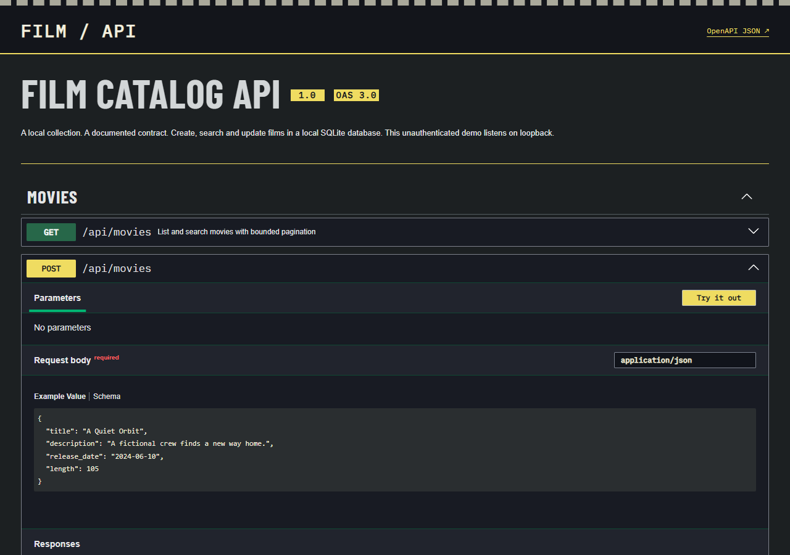

# Film catalog API

A NestJS + TypeORM API for a personal film collection, with validated CRUD, pagination, a real database migration and an interactive OpenAPI console.



This is a refreshed portfolio edition of an earlier technical exercise. The current implementation, demo data and interface were revised in 2026. It is a local learning/demo application; deployment, accounts and production operations are outside its scope.

The cinematic console styles the actual Swagger operations and schemas. Request bodies have explicit accessible labels; endpoint expansion remains keyboard-operable. Barlow Condensed and IBM Plex Mono are bundled under the SIL Open Font License with notices in `public/fonts`.

## Run

Requires Node.js 22.13+ (tested with 22.23.4) and npm. The local database uses SQLite via `sql.js`, so no remote credentials, Docker daemon or native database install is needed.

```sh
npm ci
npm run build
npm start
```

Open http://127.0.0.1:4431/docs. Expand **POST /api/movies**, choose **Try it out**, then **Execute**. The example is fictional. Copy the returned ID to try GET, PATCH and DELETE. The collection starts empty.

```json
{
  "title": "A Quiet Orbit",
  "description": "A fictional crew finds a new way home.",
  "release_date": "2024-06-10",
  "length": 105
}
```

The machine-readable schema is http://127.0.0.1:4431/docs-json.

## Contract

| Method | Route                                   | Result                       |
| ------ | --------------------------------------- | ---------------------------- |
| GET    | `/api/movies?q=orbit&offset=0&limit=20` | `{items,total,offset,limit}` |
| POST   | `/api/movies`                           | Created film, 201            |
| GET    | `/api/movies/:id`                       | Film, or 404                 |
| PATCH  | `/api/movies/:id`                       | Partial update, or 404       |
| DELETE | `/api/movies/:id`                       | 204, or 404                  |

Titles contain 1–200 characters and descriptions 1–1000, after trimming. `release_date` must be a real calendar date in `YYYY-MM-DD` format. `length` is an integer duration of 1–1440 minutes. IDs are UUID v4. Unknown fields, empty patches and null fields are rejected with 400. A missing update never creates a new film.

Search performs a literal case-insensitive substring match on titles, with at most 100 characters. Pagination defaults to 20 and caps at 100. Results sort by creation time descending with an ID tie-breaker; the count is before pagination. Offset pagination is intended for a small collection and can shift while records are added or removed.

## Persistence and structure

- `src/app.ts`: dependency injection, database lifecycle, global validation and Swagger.
- `src/movie.dto.ts`: request rules and response schema.
- `src/movies.controller.ts`: HTTP surface.
- `src/movies.service.ts`: injected repository operations.
- `src/movie.entity.ts`: stored film model.
- `src/migration.ts`: explicit initial schema; automatic schema synchronization is disabled.

The migration runs on startup and records itself in the database migration table. Changes are saved to `data/films.sqlite`, excluded from Git. Set `DB_FILE` for another local path and `PORT` for another port (default 4431). One process owns each database file. Stop the server before copying or resetting it. Deleting the file starts a new empty database on the next run.

The earlier edition mixed database engines and initialized a separate global connection. This edition uses one injected SQL.js datasource with the same lifecycle as the application, avoiding remote configuration and dialect-specific returning clauses.

## Checks

```sh
npm test
npm run format:check
npm audit
```

Tests boot a real Nest application and temporary SQLite database, run migrations, send actual HTTP requests, close and restart the application, then verify persistence, validation, bounded pagination and missing-record behavior. Swagger provides a browser consumer for the same endpoints.

This is a loopback-only, unauthenticated demo. A shared service would need authentication, deployment configuration, backups and a server database suited to its write load. `sql.js` holds the database in memory and persists snapshots, so it is intended here for a small local collection.

Third-party dependencies retain their licenses. A distribution license for this project has not been selected.
